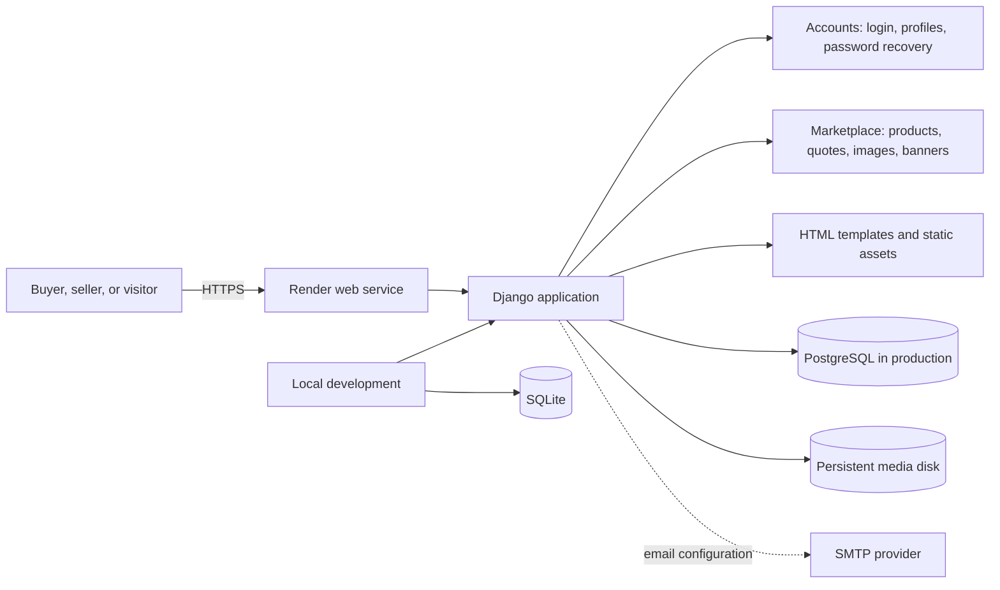
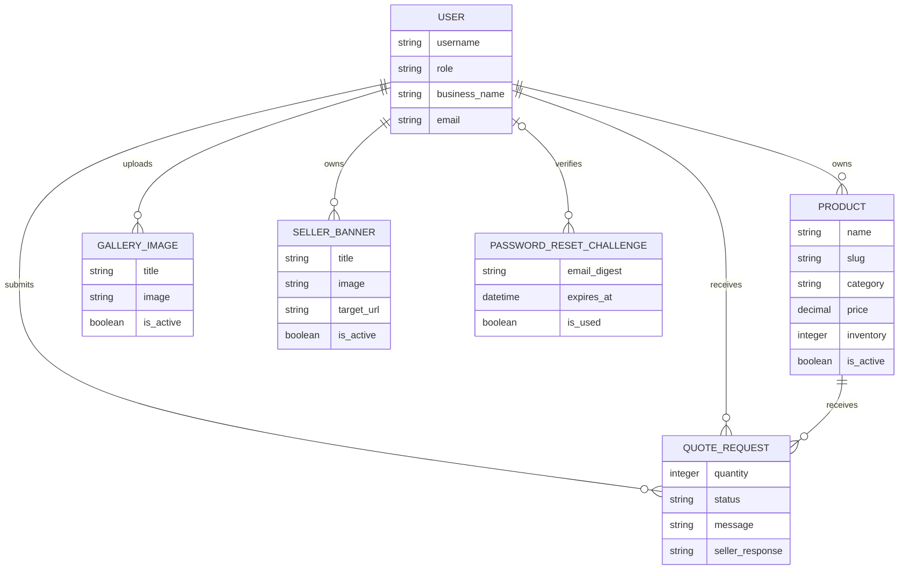

# GAB Platform

## Live demo

**Live demo:** [https://www.gabpt.com](https://www.gabpt.com). This configured
public domain was not reachable when this README was updated.
The link will work as a live demo once DNS and the Render deployment are active.

## Architecture



In production, Render runs Django with PostgreSQL and a persistent disk for
uploaded media. Local development uses SQLite. Password-reset email is sent
through SMTP when the mail environment variables are configured.

## Database relationships



Products can remain after their owner is deleted; quote requests protect their
product and are deleted with either associated user. Gallery images and seller
banners are deleted with their owner. A password-reset challenge can be
unassociated with a user.

## Screenshots and demo video

UI screenshots and a short walkthrough video are not included in this checkout.
Add captures from the deployed or locally running app under `docs/media/` and
embed them here once available; no example captures are shown as if they were
the real application.

## Setup

Create and activate a virtual environment, then install the dependencies:

```powershell
py -m venv .venv
.\.venv\Scripts\Activate.ps1
pip install -r requirements.txt
```

For local development, set `DJANGO_DEBUG` to `true`. A local signing key can
be generated in PowerShell; keep it private and do not commit it:

```powershell
$env:DJANGO_DEBUG = "true"
$env:DJANGO_SECRET_KEY = (py -c "import secrets; print(secrets.token_urlsafe(50))")
```

Then initialize the database and start the development server:

```powershell
py manage.py migrate
py manage.py runserver
```

## Marketplace workflow

Industry, wholesaler, and shopkeeper accounts can add and manage products from
their dashboard or the **My Products** navigation link. Published products
can include a product photo and appear in the catalog with the seller's
business name and location. Signed-in users can request a quote from a listing;
buyers can follow replies under **My Enquiries**, and sellers can respond
under **Quote Requests**. Signed-in users can also upload and manage business
photos from **My Images**. Business sellers can create, edit, pause, and
publish image advertisements from **My Ads**; active banners appear on the
homepage and product catalog. Visitors can switch between light and dark
themes, and their choice is saved in their browser.

### Password recovery email

The login page includes email-code password recovery. A code is single-use,
expires after 10 minutes, and allows at most five verification attempts.
Requests are rate-limited per email address and IP address. For local
development, the code is printed to the runserver console. For production,
configure `EMAIL_HOST`, `EMAIL_PORT`, `EMAIL_HOST_USER`,
`EMAIL_HOST_PASSWORD`, `DEFAULT_FROM_EMAIL`, and `EMAIL_USE_TLS` in the
deployment environment. Keep mail credentials private; the repository's
Render Blueprint prompts for these values.

Apply migrations after pulling changes that add or update database models:

```powershell
py manage.py migrate
```

The application uses SQLite locally. The database, uploaded media, and virtual environment are excluded from version control.

The production server uses [`gab.production`](./gab/production.py). It requires
a configured `DJANGO_SECRET_KEY` and `DATABASE_URL`, refuses to start with
debug mode enabled, and enforces HTTPS and secure cookies. `runserver` continues
to use the local `gab.settings` module. Render sets
`DJANGO_SETTINGS_MODULE=gab.production` in its Blueprint.

## Publish GAB on Render

The repository includes a Render Blueprint in `render.yaml`. It provisions a
web service, PostgreSQL database, persistent image-upload disk, migrations,
and a health check. The database and disk are paid resources; review Render's
current prices before applying the Blueprint.

1. Push the project to the GitHub repository and create a Render account.
2. In the Render Dashboard, create a **New Blueprint Instance** and connect
   `Shoury-Singh/GAB-Marketplace`. Review the listed service, database, disk, region,
   and prices before confirming. The Blueprint wires the database and disk to
   the web service automatically.
3. Configure SMTP in the web service's environment when you are ready to enable
   password-reset email: set `EMAIL_HOST`, `EMAIL_HOST_USER`,
   `EMAIL_HOST_PASSWORD`, and `DEFAULT_FROM_EMAIL`. The default port is 587 with
   TLS enabled. Until these are set, password reset emails cannot be delivered.
   Keep provider secrets in Render's environment settings, not in Git or chat.
4. Wait for the deployment to finish and confirm `/health/` returns `ok` at
   the generated `*.onrender.com` address. Create test buyer and seller
   accounts, publish a product and banner, and test password recovery before
   sharing the URL.

Image uploads use the service's persistent disk at `/var/data/media`. Django
serves these files through its configured media storage. If you later switch to
S3-compatible storage, configure the `AWS_STORAGE_BUCKET_NAME` and
`AWS_S3_*` environment values in Render; keep access keys private.

### Use `www.gabpt.com` as the public website address

The app is configured to accept `gabpt.com` and `www.gabpt.com` on Render,
including HTTPS form submissions. This does not register the domain or make it
live by itself; you need to own the domain and deploy GAB first.

1. Register `gabpt.com` with a domain registrar and keep access to its DNS
   settings.
2. Deploy GAB on Render and open the web service's **Settings → Custom
   Domains**. Add both `gabpt.com` and `www.gabpt.com`.
3. In the domain's DNS control panel, create the records Render requests for
   each hostname. Use the exact record type and target shown by Render; DNS
   targets can vary by provider and should not be guessed.
4. Wait for DNS to propagate and for Render to issue the HTTPS certificate.
   Then visit `https://www.gabpt.com` and check `https://gabpt.com`.
5. If you change domains, set the Render `GAB_CUSTOM_DOMAIN` environment
   variable to the new root domain (without `www` or `https://`) and redeploy.

Render's custom-domain settings are required in addition to the DNS records.
Keep `DJANGO_SECRET_KEY`, database credentials, storage credentials, and email
credentials private. Render service, database, object storage, and domain costs
depend on the plans and registrar you choose; check current pricing before
creating paid resources.

The deployed database is separate from local `db.sqlite3`; existing local
accounts and listings will not appear online unless intentionally migrated.
Uploaded images are stored in the configured object-storage bucket.

## Install GAB from Chrome

The site includes an installable web-app manifest and a Chrome install button.
After deployment on HTTPS, open the GAB website in Chrome and choose **Install
GAB** if the button is offered. Chrome's menu also has an install option. This
adds the website as an app on the device; it is not a separate Chrome Web Store
extension. The root-level `serviceworker.js` caches the app manifest and icons
and shows a simple offline message when a page cannot be reached. Dynamic
pages and account data are not stored in the service-worker cache.

The Python dependency file is `requirements.txt`; run
`pip install -r requirements.txt` to install the backend dependencies.

## Marketplace roadmap

The current marketplace supports seller product listings and buyer/seller
quote requests. A full retail-style selling flow is a later milestone:
shopping cart, addresses, order management, payment-provider integration,
shipping/fulfillment, refunds, and customer notifications. Payment processing
should only be enabled after choosing a payment provider and completing its
merchant onboarding.
