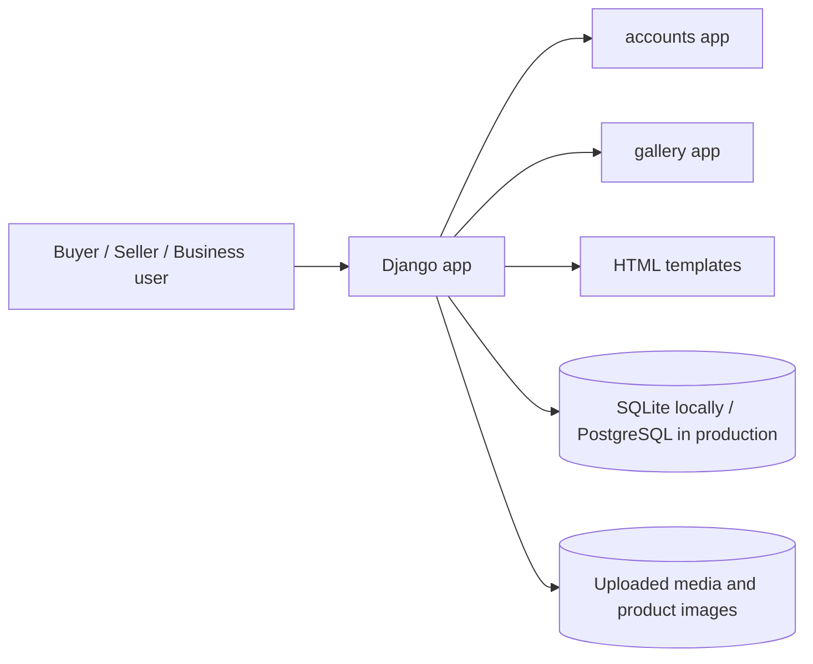

# GAB Platform

GAB Platform is a role-based B2B marketplace for the Indian supply chain. It connects industries, wholesalers, shopkeepers, and buyers in a single platform where product discovery, business profiles, order requests, and role switching are tailored to the user’s current business context.

This project is implemented in Django and is designed around the actual workflows visible in the live UI: shopkeepers manage their storefronts, buyers discover nearby shops, sellers publish products, and one account can hold multiple business roles without changing login credentials.

## Overview

The application brings together four business relationships in one ecosystem:

- Industry / Factory / Company: supply makers and manufacturers
- Wholesaler: source from industry and supply to shopkeepers
- Shopkeeper: operate a retail storefront and manage products/inventory
- Buyer / Customer: browse nearby shops and request orders directly

The screenshots provided for this project show the key screens that power this system: shopkeeper dashboard, seller product management, customer marketplace, role settings, and profile management.

## Core product experience

### 1) Shopkeeper dashboard

The first dashboard screenshot shows the primary shopkeeper landing page. It includes:

- role-aware header navigation
- summary tiles for pending orders, enquiries, active products, and business actions
- quick actions such as open/close shop and view profile
- a branded storefront-style dashboard with visual merchandising and product-focused layout

This is the operational control center for a seller running a shop or storefront.

### 2) Seller tools and product management

The seller tools screen is built for daily business operations. It shows a product management area with:

- published/unpublished status badges
- price and stock visibility
- edit, listing, and hide actions for each product
- a prominent "Add product" action for new listings

The design focuses on quick visibility and low-friction management for store owners.

### 3) Customer marketplace and local discovery

The marketplace view demonstrates the buyer-facing experience. It provides:

- a hero section titled "Explore local shops"
- local shop cards with business names, location, and product counts
- open/closed status indicators
- quick call-to-action buttons to visit a shop

This is the main discovery flow for customers looking for nearby stores and product availability.

### 4) Role management and account settings

The settings pages show one of the project’s defining features: multi-role accounts. A single user can belong to multiple marketplace roles and switch active context without re-registering.

The UI includes:

- role pills for currently assigned roles and active role
- PIN code input for nearby shop sorting
- switch-role controls that update navigation and dashboard behavior
- account expansion for adding buyer, shopkeeper, wholesaler, or industry access

### 5) User profile and business identity

The profile dashboard summarizes the user’s identity and role-specific account information. It captures:

- full name and username
- email and role
- business name and location
- PIN code and phone number
- member since date
- dashboard, manage roles, and logout actions

This page confirms the app’s consistent profile experience and role-aware identity model.

## Features

### Role-based access

Users are not limited to a single function. The project supports multiple assigned roles and one active role at a time.

Each seller role keeps its own business name, contact details, and location. Account Settings edits the active role's profile, so switching between Shopkeeper and Wholesaler does not overwrite either business identity; buyer PIN settings remain separate.

### Nearby shop discovery

Buyers can save a six-digit Indian PIN code and discover nearby shopkeepers based on approximate distance. This is a major part of the marketplace experience and is visible in the settings and market UI.

### Supply-chain catalog logic

The catalog follows the trade hierarchy:

- Industries supply wholesalers
- Wholesalers supply shopkeepers
- Shopkeepers serve buyers and consumers

This flow is built directly into the app navigation and product visibility logic.

### Explainable product discovery

The default catalog order uses a deterministic recommendation baseline within the
existing next-supplier role boundary. It combines accepted, processing, shipped,
or delivered orders and quantities, prior product interactions, price history,
stock, approximate PIN-code distance, and marketplace order popularity. Suggestions
include plain-language reasons and new users receive a popularity, availability,
and location-based fallback. Explicit rating, price, and nearest sorting remain
available.

Authenticated product views, recommendation clicks, searches, and quote requests
are recorded for future ranking evaluation. Search text is stored only as a
one-way hash, and no IP address or device identifier is collected. This is a
baseline rather than a trained ML model; seller demand forecasting is deferred
until there is sufficient order history.

### Product, banner, and image management

Sellers can manage both product listings and promotional content. This includes product publishing, image asset handling, and banner-based business promotion, giving brands a more complete storefront profile.

Shopkeeper and wholesaler image galleries are private to their owner. Only those
roles can upload, edit, or delete their own gallery images; buyers and other
suppliers cannot browse them, and buyers do not see gallery navigation.

### Orders, quotes, and enquiries

The marketplace supports buyer enquiries and seller responses, matching the business pattern shown in the dashboard summaries and seller workflow.

## Architecture



## Tech stack

- Python
- Django 6.1.2
- SQLite for local development
- PostgreSQL-ready deployment configuration
- Pillow for image handling
- WhiteNoise and static asset serving

## Repository structure

```text
accounts/              Role logic, profiles, dashboards, login/signup flows
gallery/               Catalog, product, banner, order, and quote logic
templates/             HTML templates for all screens and dashboards
static/                Branding, icons, and static front-end assets
media/                 Uploaded product and business images
manage.py              Django entry point
requirements.txt       Python project dependencies
render.yaml            Render deployment blueprint
serviceworker.js       PWA/service worker for app-style behavior
```

## Local setup

### 1) Create a virtual environment

```powershell
py -m venv .venv
.\.venv\Scripts\Activate.ps1
```

### 2) Install dependencies

```powershell
pip install -r requirements.txt
```

### 3) Set local development environment variables

```powershell
$env:DJANGO_DEBUG = "true"
$env:DJANGO_SECRET_KEY = (py -c "import secrets; print(secrets.token_urlsafe(50))")
```

### 4) Apply migrations and load the PIN code data

```powershell
py manage.py migrate
py manage.py load_pincode_locations
```

### 5) Start the app

```powershell
py manage.py runserver
```

Then open:

```text
http://127.0.0.1:8000
```

## Production notes

The project includes a Render deployment setup and supports production configuration via `gab.production`. In a real deployment, the application should be configured with secure environment variables for:

- Django secret key
- database URL
- email credentials
- HTTPS and secure cookie settings
- media storage configuration

## Why this project stands out

GAB is more than a simple catalog; it is a role-aware commerce system shaped around real business behavior. The product demonstrates how a single platform can support multi-role business onboarding, local discovery, product selling, and role switching in a clean and modern UI.

The screenshots included in this task are strong evidence of the product’s intended experience: the app is polished, business-focused, and clearly tuned for a real supply-chain marketplace rather than a generic demo storefront.

## License

This project is provided as a working application for business marketplace use and should be reviewed for deployment-specific licensing, privacy, and compliance requirements before production release.


## Payments and transaction records

Order fulfilment status and payment status are separate. A seller can report
bank transfer, business credit, cash, or external UPI payment against an
accepted order. GAB records the method, optional reference, reporting user,
and timestamp, and labels it seller-reported rather than independently verified.

PaymentAttempt amounts are stored as integer paise. CommissionLedger snapshots
the seller's commission plan when payment is recorded. The early-adopter plan
starts at 100 basis points (1%); GST remains unconfigured until GAB's CA confirms
the applicable rate and invoice treatment.

Prepare draft monthly commission statements with:

    python manage.py generate_commission_statements
    python manage.py generate_commission_statements --month 2026-10

Payout profile references and onboarding status are managed in Django Admin.
GAB does not store bank account numbers or KYC documents. Hosted checkout and
provider webhook adapters remain disabled until GAB selects a provider, obtains
written marketplace-flow approval, and configures sandbox credentials. A
provider adapter must verify the original webhook body, deduplicate event IDs,
check order amount and currency, and call record_verified_provider_capture.
Browser redirects must never mark an order paid.


### Razorpay Route sandbox switch

The Razorpay Route adapter stays off unless all of these server environment
values are configured: GAB_PAYMENT_PROVIDER=razorpay_route,
GAB_RAZORPAY_ROUTE_APPROVED=true, GAB_RAZORPAY_KEY_ID,
GAB_RAZORPAY_KEY_SECRET, and GAB_RAZORPAY_WEBHOOK_SECRET. Set the approval
switch only after the provider and GAB's adviser approve the exact marketplace
fund flow. Each seller also needs an active Route linked account, and the
commission plan needs a CA-confirmed GST rate before checkout can start.

Configure Razorpay to send payment.captured and payment.failed events to
/images/payments/webhooks/razorpay-route/. Only the signed provider webhook
changes an online order to paid. Browser checkout results only display a
pending-confirmation message.
